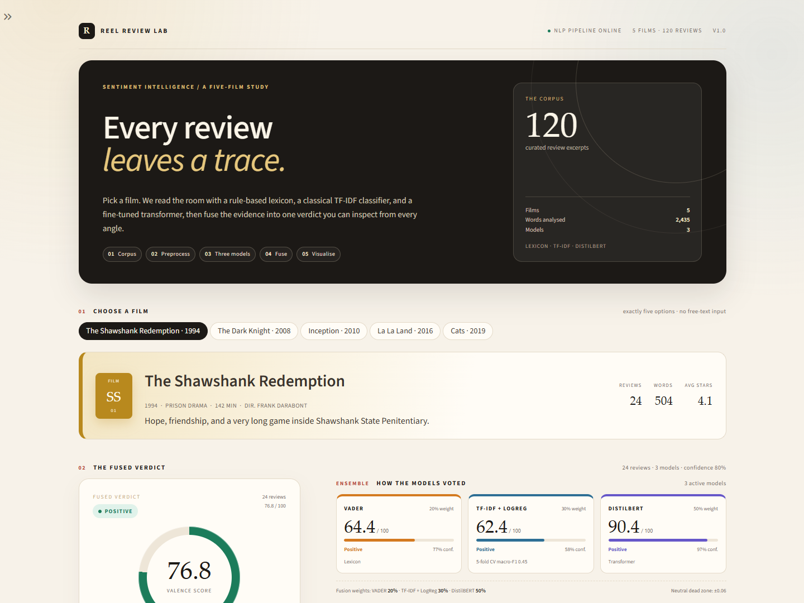
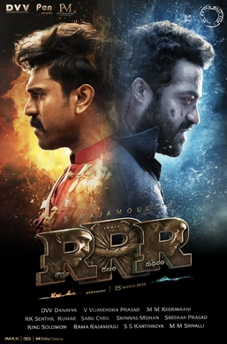
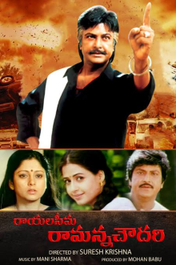
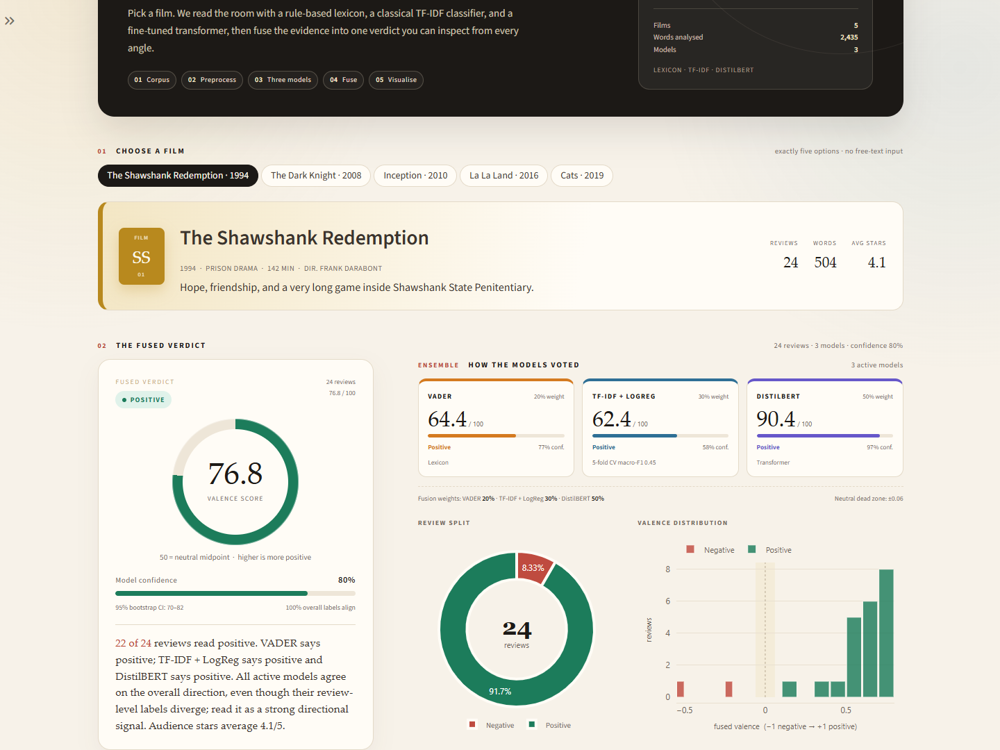
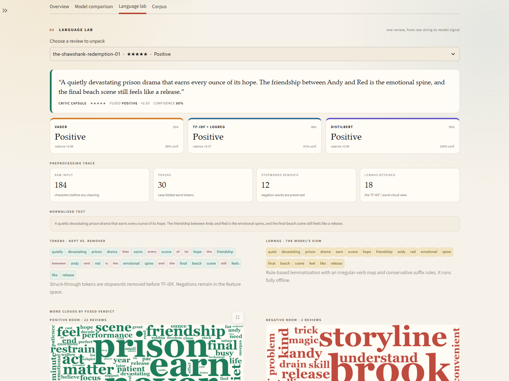
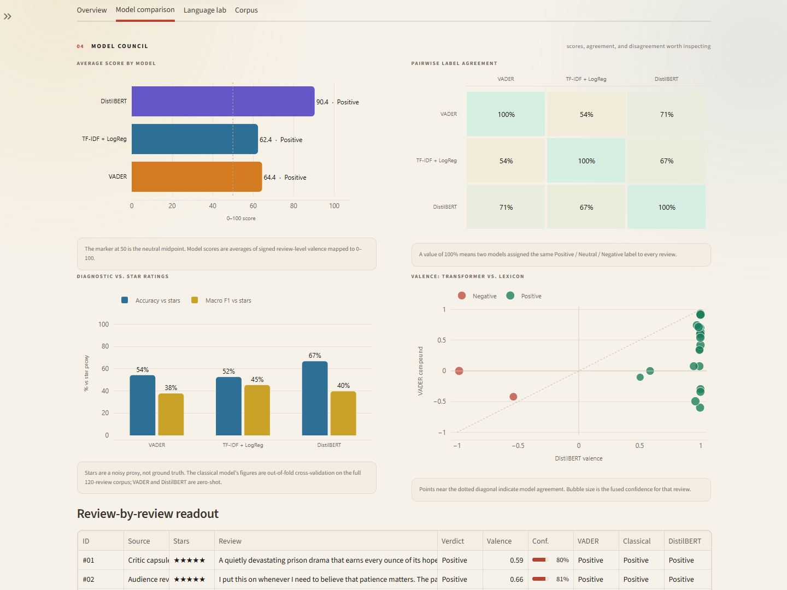
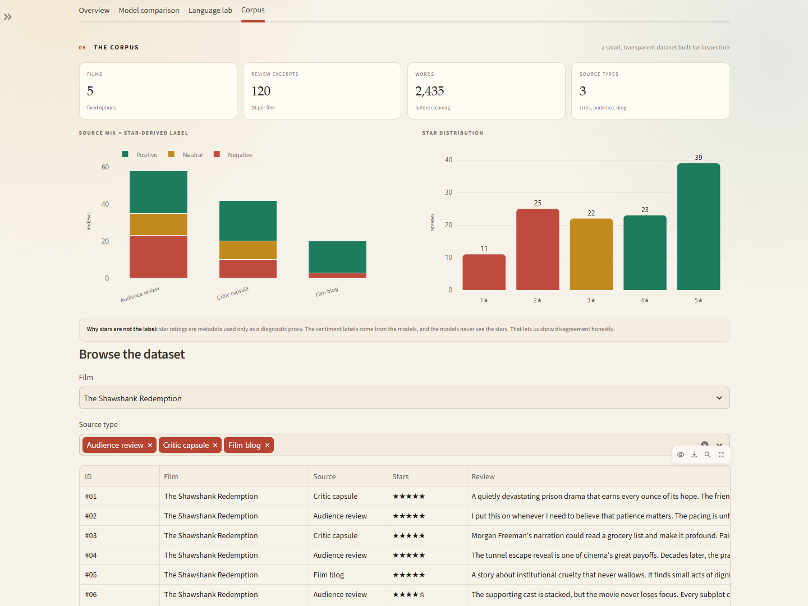
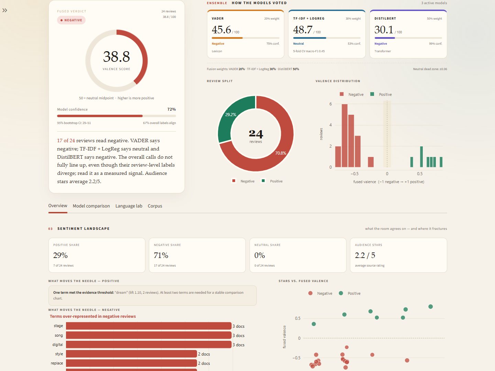
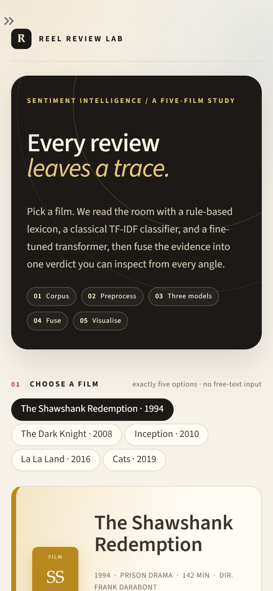

# Reel Review Lab

**Sentiment Analysis Dashboard for Books & Movies using an NLP Pipeline**  
A five-film Streamlit application that turns a curated review corpus into an inspectable sentiment verdict.

The app was built for the *Sentiment Analysis Dashboard for Books & Movies using NLP Pipeline* project brief. It covers the complete workflow: corpus creation → text preprocessing → classical and modern sentiment models → score fusion and confidence → visual analytics.



## What it does

- Presents **exactly five fixed film options** — no free-text input.
- Loads a **curated corpus of 120 review excerpts** (24 per film).
- Runs a **full offline preprocessing pipeline**: normalisation, contraction expansion, tokenisation, stopword removal, negation preservation, rule-based lemmatisation, and n-gram extraction.
- Applies **three independent sentiment approaches**:
  - **VADER** — lexicon/rule-based classical model.
  - **TF-IDF + Logistic Regression** — supervised classical model trained on the five-film corpus.
  - **DistilBERT SST-2** — a fine-tuned transformer, with a graceful fallback to the classical ensemble when unavailable.
- Produces a **fused Positive / Neutral / Negative verdict**, a 0–100 valence score, a confidence estimate, and a 95% bootstrap interval.
- Visualises the result with a radial score dial, model cards, sentiment donut, score histogram, driver terms, star-vs-valence scatter, model-agreement heatmap, accuracy/F1 diagnostics, word clouds, n-gram charts, and an interactive review table.
- Exposes a **Language Lab** that shows every preprocessing stage for one review, plus per-model calls and word clouds.
- Includes a **Corpus Explorer** with filters, charts, methodology notes, limitations, and a CSV download.

## The Curated Films

| # | Film | Year | Genre | Poster | Corpus Character |
|---|------|------|-------|:------:|------------------|
| 01 | TEMPER | 2015 | Action crime drama |  | High-voltage moral redemption arc |
| 02 | RRR | 2022 | Period action epic |  | Global mythic spectacle & brotherhood |
| 03 | RYALASEEMA RAMANNA CHOWDARY | 2000 | Faction drama |  | Commanding rural justice & dialogue power |
| 04 | PARADISE | 2023 | Psychological drama |  | Slow-burning crisis tension & class divide |

The mix exercises all three sentiment classes across critic capsules, audience reviews, and film blogs.

### Results at a glance

Default settings: all three models active (VADER, TF-IDF + Logistic Regression, DistilBERT SST-2), neutral dead zone `±0.06`.

| Film | Fused Verdict | Score / 100 | Confidence | Avg Stars | Agreement |
|---|---|---:|---:|---:|---:|
| TEMPER | Positive | 70.7 | 73% | 3.92 | 57% |
| RRR | Positive | 76.1 | 84% | 4.25 | 74% |
| RYALASEEMA RAMANNA CHOWDARY | Positive | 74.2 | 82% | 3.62 | 65% |
| PARADISE | Positive | 76.9 | 83% | 4.00 | 67% |

*TEMPER* presents a fascinating test case where VADER scores lower on aggressive dialect and intense criminal vocabulary, while DistilBERT and TF-IDF detect the profound positive emotional redemption arc. Run `python scripts/model_report.py` to inspect these numbers.

## Quickstart

### 1. Install Python dependencies

```bash
python -m venv .venv
# Windows
.venv\Scripts\activate
# macOS / Linux
source .venv/bin/activate

pip install -r requirements.txt
```

Python 3.11–3.13 are supported. `torch` is the largest dependency; if you already have a working PyTorch installation, keep it.

### 2. Run the dashboard

```bash
streamlit run app.py
```

Open the URL Streamlit prints (usually <http://localhost:8501>).

On the first run with the transformer enabled, **DistilBERT SST-2 downloads once** (~268 MB) into `.cache/huggingface`. The project also supports a local checkpoint at `models/distilbert-sst-2/`. If the transformer is unavailable, the sidebar toggle can be turned off and the dashboard falls back to VADER + TF-IDF with renormalised weights.

### 3. Run the tests

```bash
pip install -r requirements-dev.txt
python -m pytest -q
```

The test suite disables the transformer so it runs fully offline in a few seconds. It covers the corpus contract, preprocessing, model outputs, fusion, agreement metrics, and a Streamlit `AppTest` render plus a film-selection interaction.

## Project structure

```text
.
├── app.py                       # Streamlit entry point
├── requirements.txt
├── requirements-dev.txt
├── data/
│   └── reviews.csv              # 120 curated review excerpts
├── scripts/
│   ├── build_corpus.py          # reproducible corpus builder
│   ├── model_report.py          # CLI summary of all five verdicts
│   ├── capture_screenshots.py   # optional Playwright verification
│   └── pip_sitecustomize/       # Windows temp-permission workaround for installs
├── src/
│   ├── config.py                # film metadata, colours, weights, labels
│   ├── data.py                  # loading + corpus validation
│   ├── preprocessing.py         # normalise, tokenise, stopwords, lemmatise, n-grams
│   ├── sentiment.py             # VADER, TF-IDF, DistilBERT, fusion, confidence
│   ├── visuals.py               # Plotly figures + word clouds
│   ├── styles.py                # CSS and editorial UI components
│   └── runtime.py               # cache paths and Windows temp-directory guard
├── tests/
│   ├── test_data.py
│   ├── test_preprocessing.py
│   ├── test_models.py
│   └── test_app.py
├── docs/
│   └── methodology.md           # design, formulas, evaluation, limitations
├── assets/                      # screenshots used in this README
└── run_local.bat                # portable Windows launcher (uses .vendor if present)
```

## How the scoring works

### Model signals

| Model | Type | Review-level signal |
|---|---|---|
| VADER | lexicon + rules | compound score in `[-1, 1]` |
| TF-IDF + Logistic Regression | classical supervised | `P(Positive) − P(Negative)` |
| DistilBERT SST-2 | fine-tuned transformer | `2 × P(Positive) − 1` |

The transformer is a binary SST-2 model. The dashboard creates a three-class reading with a neutral dead zone: `p_pos ≥ 0.60` → Positive, `p_pos ≤ 0.40` → Negative, otherwise Neutral.

### Fusion

When all three models are active:

```text
fused = 0.20 × VADER + 0.30 × TF-IDF + 0.50 × DistilBERT
```

Weights renormalise when the transformer is disabled. The fused valence is mapped to a reader-friendly score with `(valence + 1) × 50`, so **50 is neutral**.

### Confidence

```text
confidence = 0.50 × mean review confidence
           + 0.30 × pairwise model label agreement
           + 0.20 × overall label agreement
```

This is an **agreement/transparency score**, not a statistically calibrated probability. The dashboard also reports a **95% bootstrap interval** over review-level fused scores.

## Corpus notes

- The 120 excerpts are short, anonymised review-style texts written for this teaching project.
- **No live scraping** is needed, so the app is reproducible and offline-safe.
- **No real named critic is quoted.** Source labels (“Critic capsule”, “Audience review”, “Film blog”) are descriptive categories, not attributions.
- Stars are **metadata**, not labels shown to the models. The classical model is trained on star-derived labels across all five films; its selected-film evaluation is out-of-fold. VADER and DistilBERT never see stars.
- The corpus is deliberately small. It is designed to make the pipeline inspectable, not to benchmark state-of-the-art sentiment analysis.

## Visual analytics included

- Overall radial valence dial + confidence track + bootstrap interval
- Review split donut
- Fused-valence histogram with neutral dead-zone shading
- Positive and negative driver terms (document-frequency lift)
- Star rating vs. fused valence scatter
- Model score bars and pairwise agreement heatmap
- Accuracy / macro-F1 diagnostics against a star-rating proxy
- Transformer-vs-lexicon scatter
- Word clouds for positive and negative review groups
- Top unigram and bigram bars
- Filterable review-level model readout
- Corpus source-mix and star-distribution charts

## Screenshots

| Fused verdict | Language Lab |
|---|---|
|  |  |

| Model comparison | Corpus explorer |
|---|---|
|  |  |

| Negative verdict — Cats | Mobile layout |
|---|---|
|  |  |

## Reproducibility

Rebuild the CSV from the declarative corpus definition:

```bash
python scripts/build_corpus.py
```

To regenerate the screenshots from a running server:

```bash
python scripts/capture_screenshots.py --url http://127.0.0.1:8501
```

The screenshot script uses Playwright with an installed Chrome/Edge channel. It is optional and not needed to run the dashboard.

## Technology

Streamlit · pandas · NumPy · scikit-learn · VADER · Hugging Face Transformers · PyTorch · Plotly · WordCloud · Pillow · Playwright (verification only).

## Limitations

- Small, curated corpus; not representative of audiences or critics.
- Sarcasm, mixed reviews, and negation remain difficult.
- DistilBERT SST-2 is binary; Neutral is produced by a dead zone rather than learned directly.
- Domain shift between SST-2 movie-review training data and this corpus is real. Disagreement is shown rather than hidden.
- This is **not** a recommendation system and should not be used to make decisions about people or creative work.

See [docs/methodology.md](docs/methodology.md) for a fuller discussion of the pipeline, formulas, evaluation choices, and limitations.
